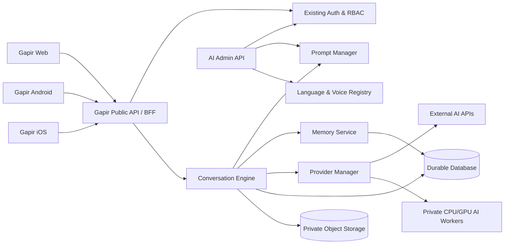
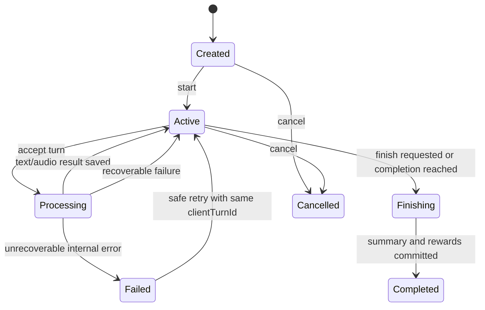
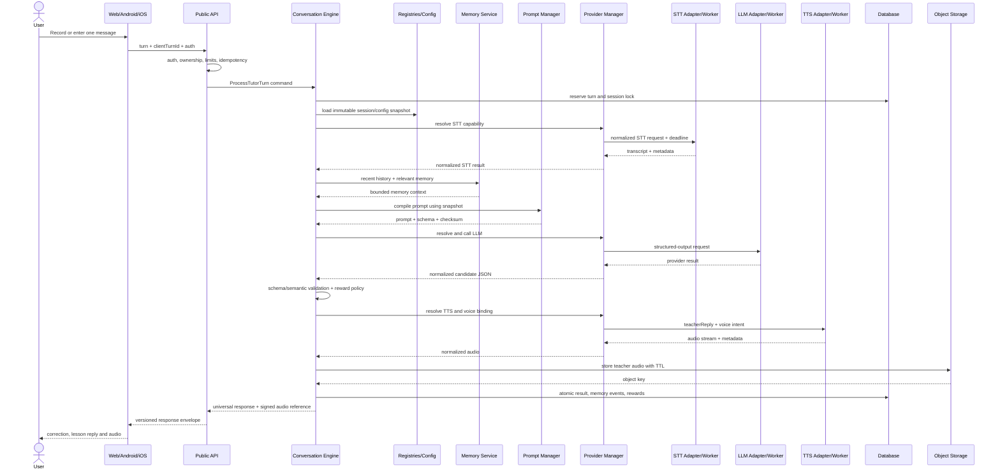
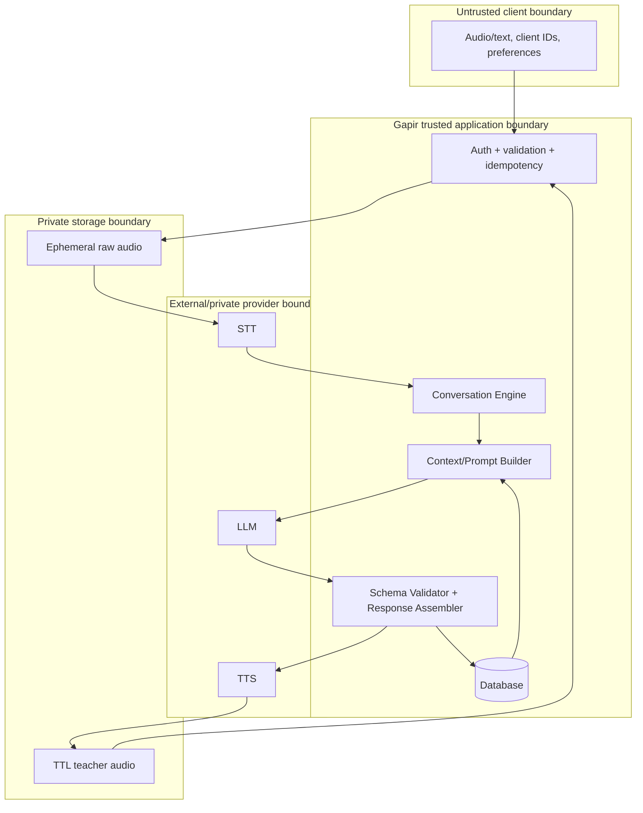

# Gapir AI Platform Blueprint — Stage 2.5

Дата: 4 августа 2026 года.  
Статус: архитектурная спецификация для согласования.  
Версия документа: `1.0-draft`.  
Связанные документы: `AI_TUTOR_ANALYSIS.md`, `AI_TUTOR_ARCHITECTURE.md`, `THIRD_PARTY_LICENSES.md`.

## 0. Статус и границы этапа

Этот документ фиксирует целевую архитектуру AI-платформы Gapir до начала реализации Stage 3. Он расширяет архитектуру Stage 2 от одного двуязычного AI Tutor до платформы, в которой языки, модели, провайдеры, голоса, prompts и учебные сценарии заменяются конфигурацией и версиями, а не переписыванием бизнес-логики.

В рамках Stage 2.5:

- не создаются API routes, UI, Prisma migrations, providers или AI workers;
- не меняется основной код приложения;
- не загружаются модели и не вызываются платные AI API;
- не создаётся admin UI;
- фиксируются контракты, границы модулей, данные, безопасность и эксплуатационные требования;
- Stage 3 не начинается до отдельного подтверждения.

Термин `provider` означает адаптер к облачному API или локальному runtime. Термин `model` означает конкретную модель/версию внутри provider. Provider никогда не является частью учебной бизнес-логики.

## 1. Цели, ограничения и архитектурные решения

### 1.1 Цели

Платформа должна:

1. одинаково обслуживать Web, Android и iOS;
2. поддерживать Uzbek и Chinese в первом релизе и добавлять новые языки через registry и content packs;
3. переключать STT, LLM и TTS независимо друг от друга;
4. поддерживать API, hybrid и fully local режимы;
5. хранить prompts, conversation templates и language rules вне TypeScript;
6. давать AI контекст текущей сессии и безопасную долгосрочную учебную память;
7. возвращать единый валидируемый JSON независимо от провайдера и языка;
8. позволять admin-команде версионировать, тестировать, публиковать и откатывать AI-конфигурацию;
9. обеспечивать наблюдаемость, контроль стоимости, аудит и быстрый fallback;
10. сохранять границы текущего Gapir: Next.js владеет auth и бизнес-логикой, AI runtime не владеет пользователями.

### 1.2 Не цели первой реализации

- непрерывный голосовой звонок и wake word;
- обучение собственных foundation models;
- voice cloning;
- автономная публикация prompts без проверки;
- обязательный vector database;
- хранение raw audio без отдельного согласия;
- перенос учебной бизнес-логики внутрь конкретного LLM prompt.

### 1.3 Зафиксированные решения

| Область | Решение |
|---|---|
| Оркестрация | Детерминированный Conversation Engine в серверном application layer |
| Провайдеры | Ports/adapters + registry + policy resolver; нет выбора provider в feature/UI коде |
| Контракты | Versioned HTTP API + JSON Schema/OpenAPI + внутренние TypeScript/Python DTO |
| Prompts | Файлы и неизменяемые версии, публикуемые через Prompt Manager |
| Память | Structured SQL memory сначала; embeddings — опциональный индекс позже |
| AI response | Строгий provider-neutral JSON, серверная валидация и один repair attempt |
| Тяжёлые модели | Отдельные private CPU/GPU workers, не edge/browser runtime |
| Аудио | Временный raw upload; teacher audio с TTL в private object storage |
| Offline | Подписанные language packs и тот же logical provider contract на устройстве |
| Mobile | Клиенты используют публичный API, а offline runtime — platform bridge с теми же DTO |
| Admin | Draft → validate → preview → approve → publish → rollback, с RBAC и audit log |

### 1.4 Контекст системы



Web/edge deployment может принимать запросы, проверять auth и выполнять лёгкую оркестрацию, но не должен загружать STT/TTS/LLM модели. При публикации через Sites тяжёлые workers остаются отдельными private services.

## 2. Архитектурные слои и ответственность

### 2.1 Client layer

Web, Android и iOS отвечают только за:

- запись/выбор аудио и локальную проверку размера;
- отображение state machine;
- воспроизведение teacher audio;
- отправку `clientTurnId` для idempotency;
- локальный outbox при потере сети;
- вызов on-device providers, только если установлен совместимый offline pack.

Клиент не получает provider API keys, не строит system prompt и не выбирает физическую модель напрямую.

### 2.2 Public API / BFF

Отвечает за auth, authorization, rate limits, transport validation, idempotency, ownership ресурсов, преобразование HTTP в application commands и стабильный error envelope. Public API не содержит prompts и не вызывает vendor SDK из route handler.

### 2.3 Application layer

Содержит use cases:

- `StartTutorSession`;
- `ProcessTutorTurn`;
- `FinishTutorSession`;
- `ResumeTutorSession`;
- `BuildNextLesson`;
- `SyncOfflineProgress`;
- admin publish/rollback use cases.

Conversation Engine координирует use cases, но не знает детали SDK провайдера.

### 2.4 Domain layer

Содержит provider-neutral сущности и правила: language direction, level, session state, turn state, score, reward policy, prompt reference, voice intent, memory facts, validation and transition rules.

### 2.5 Infrastructure layer

Содержит Prisma repositories, object storage, queue, provider adapters, secret resolver, metrics, distributed locks и HTTP clients к AI workers.

### 2.6 AI runtime layer

Отдельные services загружают локальные модели и реализуют внутренние STT/TTS/LLM contracts. Runtime не имеет доступа к cookie, User table, XP, coins или admin permissions.

## 3. Целевое дерево каталогов Stage 3+

Запрошенная логическая структура `backend/ai/prompts/...` адаптирована к существующему Next.js repository без искусственного второго backend. Большие prompts остаются в корневом `ai/`, серверная оркестрация — в `src/server/ai/`, локальные модели — в `services/ai-runtime/`.

```text
Gapir/
  ai/
    schemas/
      ai-response.v1.schema.json
      language-pack.v1.schema.json
      conversation-template.v1.schema.json
    prompts/
      uz_to_zh/
        conversation/
          v1/
            manifest.yaml
            system.md
            rubric.md
        travel/v1/
        restaurant/v1/
        shopping/v1/
        work/v1/
        grammar/v1/
        exam/v1/
      zh_to_uz/
        conversation/v1/
        travel/v1/
        restaurant/v1/
        shopping/v1/
        work/v1/
        grammar/v1/
        exam/v1/
    templates/
      greeting/v1/template.yaml
      restaurant/v1/template.yaml
      airport/v1/template.yaml
      taxi/v1/template.yaml
      business/v1/template.yaml
      shopping/v1/template.yaml
      travel/v1/template.yaml
      friends/v1/template.yaml
      school/v1/template.yaml
      interview/v1/template.yaml
      doctor/v1/template.yaml
    languages/
      uz-Latn-UZ.yaml
      zh-Hans-CN.yaml
    policies/
      translation-rules/
      safety/
      rewards/
    fixtures/
      contract-tests/
      evaluation-cases/

  app/
    api/v1/ai-tutor/
    admin/ai/                 # только после отдельного разрешения

  src/
    features/ai-tutor/        # platform-neutral UI model + web components
    server/ai/
      domain/
        entities/
        value-objects/
        policies/
        ports/
      application/
        commands/
        queries/
        conversation-engine/
        context-builder/
      provider-manager/
        registry/
        resolver/
        health/
        routing/
      providers/
        stt/
        llm/
        tts/
      prompt-manager/
        loader/
        compiler/
        validator/
        repository/
      memory/
        retrieval/
        write-policy/
        summarization/
      languages/
      voices/
      templates/
      config/
      security/
      observability/
      repositories/

  services/
    ai-runtime/
      contracts/
      gateway/
      workers/
        stt-faster-whisper/
        stt-funasr/
        tts-cosyvoice/
        llm-local/
      model-manifests/
      tests/

  packages/                   # при появлении mobile monorepo
    ai-contracts/
      openapi/
      json-schema/
      generated/
    language-pack-sdk/

  docs/
    AI_PLATFORM_BLUEPRINT.md
```

Правила зависимостей:

- `domain` не импортирует Next.js, Prisma, SDK vendor или filesystem;
- `application` зависит только от domain ports;
- adapters зависят от contracts, но contracts не зависят от adapters;
- prompt assets не импортируются как длинные строковые literals в TypeScript;
- clients генерируют DTO из опубликованной schema, а не копируют их вручную;
- Python/локальный runtime получает отдельную generated contract model.

## 4. Universal AI Provider Manager

### 4.1 Назначение

Provider Manager — единственная точка выбора конкретного STT, LLM и TTS. Conversation Engine запрашивает capability, а не vendor: например, `STT(zh-Hans-CN, batch, <=60s)` или `TTS(uz-Latn-UZ, female, neutral)`.

Поддерживаемые семейства adapters:

| Capability | Cloud/API adapters | Self-hosted/local adapters |
|---|---|---|
| STT | OpenAI, Azure Speech, Google Speech | Whisper, faster-whisper, FunASR, generic local runtime |
| TTS | OpenAI, Azure, ElevenLabs, Google | CosyVoice, generic local runtime |
| LLM | GPT/OpenAI, Claude, Gemini, DeepSeek, Qwen API | Qwen/local, OpenAI-compatible local gateway, generic local runtime |

Список не является enum внутри Conversation Engine. Provider IDs хранятся как стабильные strings, например `openai.stt`, `funasr.local`, `azure.tts`. Добавление adapter требует реализации порта и регистрации manifest, но не изменения engine, API contract или UI.

### 4.2 Основные объекты

- `ProviderDefinition`: тип, adapter key, capabilities, operational status.
- `ProviderDeployment`: endpoint/region/runtime, secret reference, concurrency, residency.
- `ModelDefinition`: provider, model ID, immutable revision, languages, limits, pricing class.
- `RoutingPolicy`: требования, приоритеты, fallbacks и ограничения.
- `ProviderHealth`: ready/degraded/unavailable, latency/error windows.
- `ResolvedProvider`: снимок выбора, записываемый в turn для воспроизводимости.

Секреты не хранятся в этих объектах. База хранит только opaque `secretRef`, который разрешается через environment/secret manager на сервере.

### 4.3 Унифицированные порты

```ts
interface SpeechToTextPort {
  readonly capability: "stt";
  transcribe(input: SttRequest, context: ProviderCallContext): Promise<SttResult>;
  health(): Promise<ProviderHealth>;
}

interface TutorLlmPort {
  readonly capability: "llm";
  generate(input: LlmRequest, context: ProviderCallContext): Promise<LlmResult>;
  health(): Promise<ProviderHealth>;
}

interface TextToSpeechPort {
  readonly capability: "tts";
  synthesize(input: TtsRequest, context: ProviderCallContext): Promise<TtsResult>;
  health(): Promise<ProviderHealth>;
}
```

Минимальные общие поля `ProviderCallContext`:

```ts
type ProviderCallContext = {
  requestId: string;
  sessionId: string;
  turnId: string;
  deadlineAt: string;
  idempotencyKey: string;
  locale: string;
  privacyClass: "standard" | "restricted";
  traceparent?: string;
};
```

Результаты adapters возвращают нормализованные данные и metadata; raw vendor response не выходит за adapter boundary.

### 4.4 Capability manifest

Каждый deployment объявляет:

- capability: `stt | llm | tts`;
- languages/BCP 47 ranges;
- streaming/batch support;
- structured-output support;
- audio formats, max duration и sample rates;
- voice controls: speed, pitch, style/emotion;
- context/token limits;
- data region и privacy class;
- estimated cost class;
- local/offline flag;
- model revision и license metadata;
- concurrency and timeout budget.

Manager валидирует manifest при старте и при admin publish. Невалидный deployment не участвует в routing.

### 4.5 Выбор provider

Порядок слияния конфигурации:

1. platform default;
2. environment/region policy;
3. language or direction override;
4. template/lesson requirements;
5. tenant/organization policy, если появится multitenancy;
6. user privacy/offline preference;
7. безопасный request override из allowlist для benchmark/admin preview.

Resolver фильтрует candidates по языку, capability, privacy, format, deadline и health, затем ранжирует по policy: качество → availability → latency → cost. Никакой клиентский `providerId` не принимается как доверенное значение.

### 4.6 Fallback и отказоустойчивость

- timeout на каждый этап меньше общего turn deadline;
- circuit breaker на deployment, а не на всё семейство provider;
- retry только для transient ошибок и только если запрос идемпотентен;
- STT может перейти к fallback provider до вызова LLM;
- LLM repair retry остаётся на том же model snapshot; provider fallback допускается один раз по policy;
- TTS failure не отменяет валидный текстовый ответ;
- локальный overload может переключиться на cloud только при разрешённой privacy policy;
- fallback chain имеет максимум, чтобы исключить бесконечный cascade;
- фактические provider/model/revision и причина fallback сохраняются в usage event.

### 4.7 Model lifecycle для локальных workers

Worker загружает модель один раз, публикует readiness только после warm-up, ограничивает concurrency semaphore и завершает новые requests перед rollout. Model revision, checksum, license и required resources фиксируются в manifest. Blue/green deployment исключает смешивание revisions внутри одного provider deployment.

### 4.8 Contract tests

Каждый adapter обязан пройти общий suite:

- forced language и normalization;
- timeout/cancellation;
- empty speech/no speech;
- malformed structured output;
- Unicode Uzbek apostrophes и Chinese punctuation;
- TTS format and non-empty audio;
- health transitions;
- отсутствие secret/raw payload в errors и logs.

## 5. Prompt Manager

### 5.1 Принципы хранения

Prompt состоит не из TypeScript string, а из versioned bundle:

```text
ai/prompts/uz_to_zh/restaurant/v2/
  manifest.yaml
  system.md
  rubric.md
  examples.jsonl
  tests.yaml
```

`manifest.yaml` содержит:

```yaml
id: tutor.uz_to_zh.restaurant
version: 2.0.0
schemaVersion: ai-response.v1
direction: uz_to_zh
purpose: restaurant
status: draft
compatibleTemplates: [restaurant]
supportedLevels: [A1, A2, B1]
requiredVariables:
  - nativeLanguage
  - targetLanguage
  - level
  - template
  - sessionSummary
  - recentTurns
  - userMemory
  - recognizedText
maxCompiledChars: 24000
```

### 5.2 Версии и жизненный цикл

- published version неизменяема;
- новая правка создаёт новую semantic version;
- статус: `draft`, `validated`, `approved`, `published`, `deprecated`, `archived`;
- activation связывает scope с конкретным immutable version;
- rollback меняет activation pointer, не переписывает историю;
- каждый turn сохраняет `promptVersionId` и compiled checksum;
- удаление опубликованной версии запрещено, допускается archive;
- promotion dev → staging → production происходит по одному artifact checksum.

### 5.3 Компиляция prompt

Prompt Compiler:

1. разрешает direction, purpose, level и active version;
2. загружает bundle через repository;
3. валидирует manifest/schema/checksum;
4. подставляет только объявленные variables;
5. экранирует user-generated blocks и разделяет их delimiters;
6. ограничивает history и memory token budget;
7. добавляет response schema и safety policy;
8. возвращает compiled prompt, version ID и checksum.

Templates не могут исполнять произвольный JavaScript. Разрешён только ограниченный declarative templating без filesystem/network access.

### 5.4 Prompt quality gates

До publish обязательны:

- manifest and schema validation;
- отсутствие secrets/PII;
- все variables объявлены и используются корректно;
- evaluation fixtures для направлений и уровней;
- injection tests;
- response schema pass rate;
- ручное bilingual review;
- сравнение score/reward stability;
- cost/token estimate;
- approval пользователя с ролью, достаточной для production publish.

### 5.5 Эксперименты

A/B version выбирается серверным deterministic assignment по user/session и сохраняется в session snapshot. Внутри сессии версия не меняется. Эксперимент не может обходить privacy/safety rules; результат измеряется без хранения raw prompt в обычных logs.

## 6. Conversation Templates

Сценарии Greeting, Restaurant, Airport, Taxi, Business, Shopping, Travel, Friends, School, Interview и Doctor — независимые versioned content objects. Template описывает педагогический сценарий, но не provider.

Пример declarative template:

```yaml
id: restaurant
version: 1.0.0
titleKey: ai.templates.restaurant.title
supportedDirections: [uz_to_zh, zh_to_uz]
supportedLevels: [A1, A2, B1, B2]
promptPurpose: restaurant
goals:
  - greet_staff
  - request_menu
  - order_item
  - ask_price
roles:
  teacher: waiter
  learner: guest
requiredSlots: [partySize]
optionalSlots: [dietaryPreference]
openingAct: greet_and_offer_help
completion:
  minTurns: 4
  requiredGoalsCompleted: 3
limits:
  maxTurns: 20
safetyPolicy: standard
```

Независимость означает:

- version и publish lifecycle у каждого template свои;
- один template не импортирует другой;
- ошибка/отключение Doctor не блокирует Restaurant;
- prompt ссылается на contract template, но template не содержит system prompt;
- новые templates регистрируются без нового API endpoint;
- language-specific phrasing хранится в prompt/content bundle, а не в template core.

## 7. Conversation Engine

### 7.1 Ответственность

Conversation Engine — детерминированный orchestrator. Он отвечает за:

- контекст и bounded history;
- session state и порядок turns;
- новые слова и текущие учебные goals;
- тему, уровень, последний урок и следующий вопрос;
- вызов STT → context/prompt → LLM → validation → TTS;
- memory retrieval и безопасную запись результатов;
- rewards через server-owned policy;
- idempotency и partial failure.

LLM предлагает педагогический ответ и score evidence, но не может самостоятельно начислять XP/coins или менять уровень пользователя.

### 7.2 Session snapshot

При создании сессии фиксируются:

- native/target language IDs и direction;
- current level;
- template version;
- prompt activation/version;
- routing policy version;
- voice profile and binding policy;
- memory snapshot revision;
- config version;
- experiment assignments.

Внутри сессии эти значения не меняются автоматически. Это гарантирует предсказуемый диалог и воспроизводимость.

### 7.3 State machine



На session может обрабатываться только один logical turn одновременно. Lock — database/advisory/distributed в зависимости от deployment. Повторный `clientTurnId` возвращает сохранённый результат.

### 7.4 Обработка turn

1. Auth, ownership, session status and limits.
2. Reserve idempotency record and turn ID.
3. Validate/decode audio in isolated runtime.
4. Resolve STT capability and transcribe.
5. Normalize text по Language Registry.
6. Retrieve session history, summary и relevant long-term memory.
7. Resolve template/prompt/config snapshots.
8. Compile bounded prompt.
9. Resolve LLM and request strict JSON.
10. Validate JSON Schema and semantic language rules.
11. Один repair attempt; после него stable error.
12. Server computes canonical score/rewards from validated evidence and policy.
13. Resolve TTS/voice; synthesize teacher reply when allowed.
14. Atomic commit of turn, messages, vocabulary, memory events and reward ledger.
15. Return universal response. TTS can be `null` without failing text.

### 7.5 Контекст и история

Context Builder использует отдельные budgets:

- system/policy: зарезервированная неизменяемая часть;
- template/lesson state;
- recent turns, например последние 6–12 сообщений;
- rolling session summary;
- relevant long-term memory;
- current transcript;
- response schema.

При превышении budget старые turns сворачиваются в structured summary. Последние turns никогда не заменяются summary полностью. Summary versioned, содержит facts/goals/new words/open questions и не является свободным полномочием LLM.

### 7.6 Следующий вопрос

`nextQuestion` является частью AI response, но Engine проверяет:

- язык target language;
- соответствие template goals и level;
- длину;
- отсутствие завершённого goal repetition;
- безопасность.

Если поле невалидно, Engine может использовать deterministic fallback question из template, не делая второй полный turn.

## 8. Long-term Memory System

### 8.1 Уровни памяти

| Уровень | Содержимое | Срок |
|---|---|---|
| Turn | transcript, correction, reply, evidence | внутри/после session по retention policy |
| Session | history, summary, goals, new words | вся session |
| Profile | native/target language, current level, preferences | до изменения/удаления user |
| Learning | weak/favorite topics, errors, vocabulary mastery, lesson state | долгосрочно с decay/review |
| Aggregate | dates, streak, XP, coins, counts, time spent | ledger/aggregates |

### 8.2 Данные памяти

Memory System хранит:

- родной и изучаемый языки;
- уровень отдельно для каждого target language;
- любимые и слабые темы;
- нормализованные error patterns с evidence count;
- новые слова, mastery, review dates и source context;
- статистику accuracy, fluency proxy, sessions, turns и study time;
- последний урок, template, topic и completion state;
- даты занятий, streak и timezone;
- XP и coins через idempotent ledger;
- выданные achievements;
- пользовательские voice/preferences;
- consent and retention preferences.

### 8.3 Write policy

LLM не пишет память напрямую. Он возвращает candidates/evidence, после чего Memory Write Policy:

- валидирует language and normalized key;
- требует evidence для weak topic/error;
- deduplicates word/error;
- увеличивает counters транзакционно;
- применяет confidence threshold;
- не сохраняет чувствительные свободные тексты как profile fact;
- пишет provenance: session, turn, prompt/model version;
- позволяет user удалить или исправить данные.

XP и coins вычисляются server policy и фиксируются в append-only ledger с unique idempotency key. Aggregate в User/profile может кэшироваться, но ledger остаётся источником истины.

### 8.4 Retrieval для следующего урока

`BuildNextLesson` получает:

1. активную language pair и level;
2. незавершённый lesson/template;
3. слова, у которых наступил review;
4. top weak topics с достаточным evidence;
5. recent topics для контроля разнообразия;
6. user preferences;
7. streak/date context.

Lesson policy сначала детерминированно выбирает constraints, затем LLM может сформулировать упражнения. Это предотвращает полную зависимость учебного плана от случайного ответа модели.

### 8.5 Structured SQL и embeddings

Stage 3 должен начинать со structured relational memory. Vector index нужен только для поиска больших свободных заметок/истории и добавляется как производный индекс. Canonical facts, levels, XP, coins, mastery и consent никогда не хранятся только в embeddings.

### 8.6 Privacy и lifecycle

- raw audio по умолчанию удаляется после обработки;
- user может очистить conversation history или всю AI memory;
- удаление распространяется на object storage и derived indexes;
- retention различается для operational logs, turns и teacher audio;
- экспорт памяти предоставляет понятный structured format;
- sensitive lessons (например Doctor) могут иметь более строгую memory policy.

## 9. Voice System

### 9.1 Абстрактный профиль и binding

Пользователь выбирает `VoiceProfile`, а не vendor voice ID:

```json
{
  "id": "zh.teacher.female.warm",
  "language": "zh-Hans-CN",
  "persona": "teacher",
  "genderPresentation": "female",
  "ageStyle": "adult",
  "speed": 0.95,
  "pitchSemitones": 0,
  "emotion": "warm",
  "fallbackProfileId": "zh.teacher.neutral"
}
```

Для child применяется `ageStyle: child`; это характеристика доступного лицензированного голоса, а не синтез/клонирование голоса реального ребёнка.

`VoiceBinding` сопоставляет profile с provider/model/voice ID и диапазонами controls. Один profile может иметь cloud и local bindings.

### 9.2 Capability negotiation

Если provider не поддерживает pitch или emotion, resolver:

1. выбирает binding с максимальным совпадением;
2. безопасно игнорирует unsupported optional control;
3. нормализует speed/pitch в provider-specific range;
4. записывает applied controls;
5. переключается на fallback voice только при необходимости.

Text pre-processing (numbers, abbreviations, Chinese/Uzbek punctuation) реализуется language-specific normalizer, а не внутри UI.

### 9.3 Ограничения

- no voice cloning by default;
- лицензия и commercial-use status обязательны в binding metadata;
- preview audio versioned и короткоживущее;
- admin не может привязать voice к unsupported language;
- TTS output проходит size/duration/content-type checks.

## 10. Language Registry

### 10.1 Идентификаторы

Canonical IDs используют BCP 47 и script/region там, где это существенно:

- Uzbek: `uz-Latn-UZ`;
- Simplified Chinese: `zh-Hans-CN`.

Будущие записи: `ru-RU`, `en-US`/`en-GB`, `tr-TR`, `ar`, `ja-JP`, `ko-KR`. UI locale, native language и target language — разные поля.

| Язык | Canonical registry ID | Статус Stage 2.5 |
|---|---|---|
| Uzbek | `uz-Latn-UZ` | регистрируется первым |
| Chinese | `zh-Hans-CN` | регистрируется первым |
| Russian | `ru-RU` | предусмотрен без изменения contracts |
| English | `en-US` / `en-GB` | предусмотрен без изменения contracts |
| Turkish | `tr-TR` | предусмотрен без изменения contracts |
| Arabic | `ar` с уточняемыми region/script variants | предусмотрен без изменения contracts |
| Japanese | `ja-JP` | предусмотрен без изменения contracts |
| Korean | `ko-KR` | предусмотрен без изменения contracts |

### 10.2 Language descriptor

```yaml
id: uz-Latn-UZ
baseLanguage: uz
script: Latn
direction: ltr
displayNameKey: languages.uzbek
normalizer: uzbek-latin-v1
tokenizer: unicode-word-v1
sentenceSegmenter: default-v1
levelFramework: CEFR
sttHints:
  preferredSampleRate: 16000
tts:
  defaultVoiceProfile: uz.teacher.neutral
orthography:
  apostrophePolicy: canonical-u02bb
status: active
```

Chinese descriptor дополнительно задаёт Han script, punctuation normalization, optional pinyin pronunciation representation и CER-oriented evaluation.

### 10.3 Language pair / direction

Direction — самостоятельная запись:

```text
uz_to_zh = native uz-Latn-UZ + target zh-Hans-CN
zh_to_uz = native zh-Hans-CN + target uz-Latn-UZ
```

Она ссылается на prompt activations, translation rules, supported templates, default routing and voices. Нельзя построить direction из двух произвольных клиентских strings.

### 10.4 Добавление нового языка без изменения архитектуры

Нужны:

1. language descriptor and normalization tests;
2. at least one STT, LLM and TTS capability or explicit text-only mode;
3. voice binding;
4. language direction and prompts;
5. template compatibility;
6. evaluation fixtures;
7. admin validation and publish.

Новые languages не требуют нового endpoint, новой session table или нового response schema.

## 11. Central AI Configuration

### 11.1 Источники и приоритет

- secrets: environment/secret manager only;
- immutable safe defaults: versioned config file;
- operational configuration: database revisions через Admin;
- emergency override: environment/feature flag с audit;
- session получает immutable config snapshot.

### 11.2 Конфигурационная модель

```yaml
version: 1
limits:
  maxRecordingSeconds: 60
  maxAudioBytes: 15728640
  maxMessagesPerSession: 40
  maxNewWordsPerTurn: 5
generation:
  temperature: 0.4
  maxOutputTokens: 1200
timeoutsMs:
  totalTurn: 30000
  stt: 10000
  llm: 15000
  tts: 10000
providers:
  selectedSttPolicy: stt-default-v1
  selectedLlmPolicy: tutor-default-v1
  selectedTtsPolicy: tts-default-v1
retries:
  transientProvider: 1
  schemaRepair: 1
retention:
  rawAudioSeconds: 0
  teacherAudioHours: 24
context:
  recentTurnCount: 8
  maxMemoryItems: 20
```

Timeout этапов может пересекаться только в пределах общего deadline. Конфигурация проверяет инварианты до publish, например `stt + llm + tts` не должны заведомо превышать total budget без parallel path.

### 11.3 Что нельзя менять динамически без deployment

- secret values;
- код adapter;
- trusted internal service identity;
- schema compatibility enforcement;
- максимальные safety limits, заданные infrastructure policy.

## 12. AI Admin Architecture

На Stage 2.5 проектируется только архитектура. Будущий admin раздел включает:

- AI Providers и deployments;
- AI Models;
- AI Voices и bindings;
- AI Prompts/System Prompts;
- Conversation Templates и Scenarios;
- Topics, Levels, Lessons;
- Translation Rules;
- Language Registry and directions;
- Routing/AI Configuration;
- Offline Packs;
- evaluations, rollout и audit.

### 12.1 RBAC

| Действие | Content Editor | Admin | Owner |
|---|---:|---:|---:|
| Создать draft prompt/template/topic | Да | Да | Да |
| Запустить preview/evaluation | Да | Да | Да |
| Approve content | Нет для своей версии | Да | Да |
| Publish/rollback content | Нет | Да | Да |
| Менять routing/config | Нет | Да | Да |
| Создавать provider deployment | Нет | Нет/ограниченно | Да |
| Привязать secret reference | Нет | Нет | Да |
| Emergency disable provider | Нет | Да | Да |
| Просмотреть audit | Ограниченно | Да | Да |

Действия высокой критичности могут требовать four-eyes approval. Secret value никогда не показывается после сохранения и в идеале вообще вводится вне Gapir admin через secret manager.

### 12.2 Publish workflow


Admin API записывает before/after metadata, actor, reason, timestamp, correlation ID и revision. Опубликованные artifacts read-only.

### 12.3 Preview isolation

Preview использует test user/data, отдельный cost quota и помеченный provider context. Он не начисляет XP/coins, не меняет production memory и не публикует audio URL в production bucket.

## 13. Universal AI Response Contract

### 13.1 Пример ответа `v1`

```json
{
  "recognizedText": "你好，我要一个菜单。",
  "correctedText": "你好，我想要一份菜单。",
  "translation": "Salom, men menyu olmoqchiman.",
  "grammarExplanation": "“想要” istakni tabiiyroq ifodalaydi. Menyu uchun 一份 o‘lchov so‘zi ishlatiladi.",
  "teacherReply": "当然，这是菜单。您想喝点什么？",
  "nextQuestion": "请问你想点什么饮料？",
  "newWords": [
    {
      "term": "菜单",
      "translation": "menyu",
      "transliteration": "càidān",
      "partOfSpeech": "noun",
      "example": "请给我一份菜单。"
    }
  ],
  "pronunciationTips": [
    {
      "target": "菜单",
      "tip": "“cài” to‘rtinchi, “dān” birinchi ton bilan aytiladi."
    }
  ],
  "grammarTopic": "想要 + object",
  "score": 86,
  "xp": 12,
  "coins": 2,
  "achievements": [],
  "audioUrl": "https://signed.example/audio/turn-id",
  "latency": {
    "totalMs": 3820,
    "sttMs": 840,
    "llmMs": 2050,
    "ttsMs": 760
  },
  "provider": {
    "stt": "funasr.local",
    "llm": "openai.llm",
    "tts": "azure.tts"
  },
  "model": {
    "stt": "fun-asr-nano@revision",
    "llm": "configured-model-id",
    "tts": "configured-voice-model"
  },
  "version": "1.0"
}
```

`audioUrl` — nullable signed URL с TTL; клиент не считает его постоянным. Provider/model metadata может быть скрыто в consumer UI, но полезно для support and observability.

### 13.2 JSON Schema Draft 2020-12

```json
{
  "$schema": "https://json-schema.org/draft/2020-12/schema",
  "$id": "https://gapir.example/schemas/ai-response.v1.schema.json",
  "title": "GapirAiTutorResponseV1",
  "type": "object",
  "additionalProperties": false,
  "required": [
    "recognizedText",
    "correctedText",
    "translation",
    "grammarExplanation",
    "teacherReply",
    "nextQuestion",
    "newWords",
    "pronunciationTips",
    "grammarTopic",
    "score",
    "xp",
    "coins",
    "achievements",
    "audioUrl",
    "latency",
    "provider",
    "model",
    "version"
  ],
  "properties": {
    "recognizedText": { "type": "string", "maxLength": 4000 },
    "correctedText": { "type": "string", "maxLength": 4000 },
    "translation": { "type": "string", "maxLength": 4000 },
    "grammarExplanation": { "type": "string", "maxLength": 6000 },
    "teacherReply": { "type": "string", "minLength": 1, "maxLength": 4000 },
    "nextQuestion": { "type": "string", "maxLength": 2000 },
    "newWords": {
      "type": "array",
      "maxItems": 5,
      "items": {
        "type": "object",
        "additionalProperties": false,
        "required": ["term", "translation"],
        "properties": {
          "term": { "type": "string", "minLength": 1, "maxLength": 200 },
          "translation": { "type": "string", "minLength": 1, "maxLength": 500 },
          "transliteration": { "type": ["string", "null"], "maxLength": 500 },
          "partOfSpeech": { "type": ["string", "null"], "maxLength": 100 },
          "example": { "type": ["string", "null"], "maxLength": 1000 }
        }
      }
    },
    "pronunciationTips": {
      "type": "array",
      "maxItems": 5,
      "items": {
        "type": "object",
        "additionalProperties": false,
        "required": ["target", "tip"],
        "properties": {
          "target": { "type": "string", "maxLength": 200 },
          "tip": { "type": "string", "maxLength": 1000 }
        }
      }
    },
    "grammarTopic": { "type": ["string", "null"], "maxLength": 300 },
    "score": { "type": "integer", "minimum": 0, "maximum": 100 },
    "xp": { "type": "integer", "minimum": 0, "maximum": 10000 },
    "coins": { "type": "integer", "minimum": 0, "maximum": 10000 },
    "achievements": {
      "type": "array",
      "maxItems": 10,
      "items": {
        "type": "object",
        "additionalProperties": false,
        "required": ["id", "title"],
        "properties": {
          "id": { "type": "string", "pattern": "^[a-z0-9._-]+$", "maxLength": 100 },
          "title": { "type": "string", "maxLength": 200 },
          "icon": { "type": ["string", "null"], "maxLength": 200 }
        }
      }
    },
    "audioUrl": { "type": ["string", "null"], "format": "uri", "maxLength": 2048 },
    "latency": {
      "type": "object",
      "additionalProperties": false,
      "required": ["totalMs", "sttMs", "llmMs", "ttsMs"],
      "properties": {
        "totalMs": { "type": "integer", "minimum": 0 },
        "sttMs": { "type": ["integer", "null"], "minimum": 0 },
        "llmMs": { "type": ["integer", "null"], "minimum": 0 },
        "ttsMs": { "type": ["integer", "null"], "minimum": 0 }
      }
    },
    "provider": {
      "type": "object",
      "additionalProperties": false,
      "required": ["stt", "llm", "tts"],
      "properties": {
        "stt": { "type": ["string", "null"], "maxLength": 200 },
        "llm": { "type": "string", "maxLength": 200 },
        "tts": { "type": ["string", "null"], "maxLength": 200 }
      }
    },
    "model": {
      "type": "object",
      "additionalProperties": false,
      "required": ["stt", "llm", "tts"],
      "properties": {
        "stt": { "type": ["string", "null"], "maxLength": 300 },
        "llm": { "type": "string", "maxLength": 300 },
        "tts": { "type": ["string", "null"], "maxLength": 300 }
      }
    },
    "version": { "const": "1.0" }
  }
}
```

LLM не должен генерировать canonical `xp`, `coins`, achievements, provider/model, latency или final `audioUrl`. Adapter-level LLM payload может содержать pedagogical proposal, но Universal Response Assembler перезаписывает системные поля серверными значениями.

## 14. Public API Contracts

Public contract version: `/api/v1`. Версия API отделена от response schema и prompt version.

### 14.1 Endpoints

| Method | Path | Назначение |
|---|---|---|
| `GET` | `/api/v1/ai-tutor/bootstrap` | languages, directions, levels, templates, limits, available voice profiles |
| `POST` | `/api/v1/ai-tutor/sessions` | создать session snapshot |
| `GET` | `/api/v1/ai-tutor/sessions/{id}` | resume session and state |
| `POST` | `/api/v1/ai-tutor/sessions/{id}/turns` | text or multipart audio turn |
| `GET` | `/api/v1/ai-tutor/sessions/{id}/turns/{turnId}` | polling/recovery, если async |
| `POST` | `/api/v1/ai-tutor/sessions/{id}/finish` | завершить и выдать summary/rewards |
| `POST` | `/api/v1/ai-tutor/sessions/{id}/cancel` | отменить активную session |
| `GET` | `/api/v1/ai-tutor/memory/overview` | user-visible learning memory |
| `DELETE` | `/api/v1/ai-tutor/memory` | очистить разрешённую AI memory |
| `GET` | `/api/v1/ai/offline-packs` | compatible signed pack manifests |
| `POST` | `/api/v1/ai/offline-sync` | idempotent sync offline progress |

### 14.2 Создание session

```json
{
  "directionId": "uz_to_zh",
  "levelId": "A1",
  "templateId": "restaurant",
  "voiceProfileId": "zh.teacher.female.warm",
  "clientSessionId": "uuid"
}
```

Server проверяет registry и создаёт immutable snapshot. Он не принимает system prompt, provider key/model ID или arbitrary language strings.

### 14.3 Отправка turn

`multipart/form-data`:

- `audio` либо `text`, но не оба без явного multimodal contract;
- `clientTurnId`: UUID, обязателен;
- `clientDurationMs`: hint;
- `audioFormat`: hint, сервер проверяет magic bytes;
- `offlineMetadata`: только для sync route.

Для JSON text turn:

```json
{
  "clientTurnId": "uuid",
  "input": { "type": "text", "text": "你好" }
}
```

Responses содержат `sessionId`, `turnId`, `status`, `result` по universal schema и `audioExpiresAt`. Transport envelope versioned отдельно.

### 14.4 Error envelope

```json
{
  "error": {
    "code": "STT_UNAVAILABLE",
    "message": "Speech recognition is temporarily unavailable.",
    "requestId": "uuid",
    "retryable": true,
    "retryAfterMs": 2000,
    "details": null
  }
}
```

Known codes: `UNAUTHENTICATED`, `FORBIDDEN`, `SESSION_NOT_FOUND`, `SESSION_NOT_ACTIVE`, `TURN_IN_PROGRESS`, `AUDIO_TOO_LONG`, `AUDIO_TOO_LARGE`, `AUDIO_FORMAT_UNSUPPORTED`, `SPEECH_NOT_RECOGNIZED`, `STT_UNAVAILABLE`, `LLM_UNAVAILABLE`, `AI_RESPONSE_INVALID`, `TTS_UNAVAILABLE`, `RATE_LIMITED`, `IDEMPOTENCY_CONFLICT`, `OFFLINE_PACK_INCOMPATIBLE`, `INTERNAL_ERROR`.

### 14.5 Mobile transport requirements

- OpenAPI/JSON Schema — source of truth for generated clients;
- bearer/session-token strategy для native apps, HttpOnly cookie для web;
- resumable/pre-signed audio upload may be added without changing turn domain contract;
- supported audio baseline: PCM/WAV and compressed Opus/AAC negotiated by bootstrap;
- cancellation and request deadlines supported;
- signed URLs HTTPS only and short-lived;
- no dependency on MediaRecorder, WebAudio, Service Worker or browser storage in server contract.

### 14.6 Internal worker API

Private endpoints `/internal/v1/stt`, `/internal/v1/tts`, `/internal/v1/llm` use service identity, TLS, deadline, request ID and normalized DTO. They are not proxied directly to clients and have no CORS requirement.

## 15. Database Model

Ниже логическая модель. Точные Prisma names/migrations утверждаются в Stage 3. Она расширяет существующего `User`, не создаёт вторую систему пользователей.

### 15.1 Registry and provider tables

| Model | Основные поля/ограничения |
|---|---|
| `AiLanguage` | `id` BCP47 unique, script, direction, descriptorVersion, status |
| `AiLanguageDirection` | id unique, nativeLanguageId, targetLanguageId, active, unique pair |
| `AiProviderDefinition` | id, capability, adapterKey, status; no secrets |
| `AiProviderDeployment` | providerId, region, endpointRef, secretRef, privacyClass, concurrency, status |
| `AiModelDefinition` | deploymentId/providerId, externalModelId, revision, capability manifest, checksum/license |
| `AiRoutingPolicyVersion` | immutable policy JSON, version, status, publishedAt |

### 15.2 Content and configuration tables

| Model | Основные поля/ограничения |
|---|---|
| `AiPrompt` | stable key, directionId, purpose |
| `AiPromptVersion` | promptId, semver, artifactPath/checksum, schemaVersion, status, unique version |
| `AiPromptActivation` | scope, promptVersionId, environment, activeFrom; only one active per scope |
| `AiConversationTemplate` | stable key, category |
| `AiTemplateVersion` | immutable artifact/checksum/status |
| `AiTopic` | stable key, localization keys, status |
| `AiLevel` | framework, ordinal, constraints |
| `AiLessonDefinition` | stable key, version, goals, prerequisites |
| `AiVoiceProfile` | stable abstract intent, languageId, controls/defaults |
| `AiVoiceBinding` | profileId, modelId, vendorVoiceId, supported controls, status |
| `AiConfigVersion` | immutable validated config, environment, status |
| `AiTranslationRuleVersion` | direction/scope, artifact/checksum, status |

Published version rows are immutable; active pointers are mutable with audit.

### 15.3 Runtime/session tables

| Model | Основные поля/ограничения |
|---|---|
| `AiTutorSession` | userId, directionId, levelId, templateVersionId, promptVersionId, configVersionId, memoryRevision, state, dates, counters |
| `AiTutorTurn` | sessionId, ordinal, clientTurnId, state, inputType, score, errorCode, timestamps; unique `(sessionId, clientTurnId)` and `(sessionId, ordinal)` |
| `AiTutorMessage` | turnId, role, normalized fields, languageId, content retention state |
| `AiTutorTurnResult` | turnId unique, universal response JSON/schemaVersion, canonical rewards |
| `AiAudioAsset` | owner/turn, kind, objectKey, MIME, bytes, duration, expiresAt, deletion state |
| `AiProviderCall` | turnId, stage, provider/model/revision, latency, status, fallbackReason, cost units; no raw content |
| `AiSessionSummary` | sessionId, revision, structured summary/checksum |

### 15.4 Memory and progress tables

| Model | Основные поля/ограничения |
|---|---|
| `AiUserLanguageProfile` | userId + targetLanguageId unique, nativeLanguageId, levelId, preferences, lastStudyAt |
| `AiUserTopicStat` | profileId + topicId unique, attempts, score aggregate, strength/confidence, lastSeenAt |
| `AiUserErrorPattern` | profileId + normalizedKey unique, category, count, confidence, lastEvidenceTurnId |
| `AiUserWordStat` | profileId + normalizedTerm unique, translation, mastery, reviewAt, interval, occurrences |
| `AiLessonState` | profileId + lessonDefinitionId, state, progress, lastSessionId |
| `AiMemoryEvent` | append-only event, userId/profileId, type, source turn, payload/version |
| `AiRewardLedger` | userId, sourceType/sourceId, xpDelta, coinDelta, idempotencyKey unique, createdAt |
| `AiAchievementGrant` | userId + achievementId unique, sourceId, grantedAt |

`AiRewardLedger` синхронизируется с существующей экономикой Gapir; если canonical XP уже хранится в текущем User/Profile, он становится transactional projection ledger, а не вторым независимым балансом.

### 15.5 Offline and audit tables

| Model | Основные поля/ограничения |
|---|---|
| `AiOfflinePack` | stable key/languageId/capabilities |
| `AiOfflinePackVersion` | semver, platform constraints, manifest URL, bytes, checksum, signature, license bundle |
| `AiOfflineSyncBatch` | userId, deviceId, clientBatchId unique, status, appliedAt |
| `AiAdminAuditLog` | actorId, action, resource type/id/version, before/after metadata, reason, requestId, createdAt |
| `AiEvaluationRun` | artifact versions, dataset version, metrics, status, reviewer |

### 15.6 Transaction boundaries

- turn finalization атомарно сохраняет result, messages, word/error events и reward ledger;
- provider calls могут записываться отдельно как operational events;
- TTS asset создаётся сначала pending, затем committed; orphan cleanup обязателен;
- finish session идемпотентен и не удваивает rewards;
- offline sync применяется batch transaction или возвращает per-event deterministic outcome.

## 16. End-to-end Sequence Diagram



## 17. Data Flow and Trust Boundaries



Data classification:

- secrets: never leave server/secret manager;
- raw audio: sensitive ephemeral content;
- transcript/history: user content with explicit retention policy;
- learning memory: personal data, export/delete capable;
- provider telemetry: operational metadata, no raw content by default;
- prompts/templates: internal intellectual property, no secrets;
- public bootstrap: only published safe metadata.

## 18. Future Offline Architecture

### 18.1 Language pack

Пользователь сможет скачать Uzbek, Chinese или English Pack. Pack — подписанный manifest, а не произвольный архив:

```json
{
  "schemaVersion": "1.0",
  "packId": "zh-Hans-CN.standard",
  "version": "1.2.0",
  "languageIds": ["zh-Hans-CN"],
  "capabilities": ["stt", "tts", "lesson-content", "prompts"],
  "platforms": {
    "android": { "minVersion": "...", "minRamMb": 6144 },
    "ios": { "minVersion": "...", "minRamMb": 6144 }
  },
  "artifacts": [],
  "totalBytes": 0,
  "checksum": "sha256:...",
  "signature": "...",
  "licenses": [],
  "expiresAt": null
}
```

Artifacts включают quantized models/tokenizers, language descriptor, normalizers, prompt/template bundles, voice assets, evaluation metadata и license notices. Каждый artifact имеет size, checksum and compatibility constraints.

### 18.2 On-device provider manager

Native runtime реализует те же logical ports через platform bridge:

- Android: Kotlin/NDK adapter;
- iOS: Swift/Core ML/Metal-compatible adapter;
- Web: только если runtime и storage безопасно поддерживаются, но это не базовое архитектурное требование.

Conversation domain DTO и universal response остаются теми же. Клиентский resolver выбирает only installed/signed models. Он не может объявить unknown pack trusted.

### 18.3 Offline session and sync

- device создаёт UUID sessions/turns и append-only outbox;
- local reward считается provisional;
- server sync проверяет pack/config/reward policy versions;
- duplicate event IDs ignored idempotently;
- conflicts resolve по server rules, а не last-write-wins для XP/coins;
- deleted/expired pack не удаляет user progress;
- при восстановлении сети cloud enrichment может быть отдельным opt-in, не переписывающим local result silently.

### 18.4 Supply-chain безопасность

- manifest и каждый artifact подписаны;
- checksum проверяется до активации и при запуске;
- download resume не активирует partial pack;
- license/attribution входит в pack;
- rollback list может блокировать уязвимую revision;
- pack извлекается без path traversal и с disk quota;
- модель не получает произвольный network/filesystem access.

## 19. Server Resource Matrix

Оценки ниже — planning envelope, а не гарантия. Stage 3 обязан измерить p50/p95 на целевых языках и выбранных model revisions.

| Режим | CPU | RAM | GPU | Disk | Network | Ожидаемая turn latency |
|---|---|---|---|---|---|---|
| API-first MVP | 2–4 vCPU для Next/orchestrator | 4–8 GB | Не требуется | 5–10 GB + external object storage | Стабильный outbound HTTPS, желательно 50+ Mbps | обычно 3–10 s, зависит от API/аудио |
| Hybrid, external LLM + local speech | Web: 2–4 vCPU; speech worker: 8+ cores | Web 4–8 GB; worker 16–32 GB | Опционально, рекомендуется NVIDIA 12–16 GB VRAM | 20–40 GB на worker + model cache | Низкая latency между API и worker; outbound для LLM | ориентир 2–7 s после warm-up |
| Fully local pilot | 8–16 modern CPU cores | 32 GB рекомендуемо | NVIDIA 16 GB VRAM рекомендуемо; CPU-only медленнее | 40–80 GB | Не нужен после pack/model install, кроме sync | ориентир 3–12 s, model-dependent |
| Fully local production worker pool | 16+ cores на node | 32–64 GB | 16–24+ GB VRAM на worker, по модели | 80–200 GB NVMe | Private 1 Gbps между gateway/workers | целевой p95 задаётся benchmark/SLO |

Текущий ноутбук с 8 GB RAM и Intel integrated GPU пригоден для web/API разработки и малых CPU tests, но не является целевым production host для одновременного STT + LLM + TTS.

Capacity planning учитывает:

- модель загружается один раз на worker;
- max concurrency зависит от VRAM и audio duration;
- очередь имеет bounded depth и admission control;
- холодный старт не включается в обычный ready pool;
- disk budget включает две revisions для blue/green rollout;
- внешние API требуют cost quota и egress monitoring.

## 20. Security Architecture

### 20.1 Identity and authorization

- existing Gapir auth — единственный user identity source;
- web использует secure HttpOnly SameSite cookies + Origin/CSRF checks;
- native apps используют revocable short-lived access tokens + refresh rotation;
- ownership проверяется для session, turn, memory и audio;
- admin endpoints отделены и защищены RBAC/step-up controls;
- internal workers используют service identity/mTLS or signed service tokens.

### 20.2 Input and audio security

- allowlist MIME, magic-byte inspection и decode в sandboxed worker;
- limits на bytes, duration, sample rate, channels и decompressed PCM;
- random temporary paths, no user-supplied filenames;
- cleanup in `finally` и orphan sweeper;
- antivirus/content scanning policy при постоянном хранении;
- защита от zip bombs/path traversal для offline packs.

### 20.3 Prompt injection and output safety

- system/policy blocks server-owned;
- user text помещается в явный untrusted delimiter;
- prompt variables allowlisted and escaped;
- memory content также untrusted, даже если ранее создано LLM;
- tool calling выключен, пока нет отдельной capability/policy;
- schema validation + semantic checks + string length limits;
- model response не управляет URLs, provider IDs, rewards или database commands;
- Doctor/children-facing content получает усиленную policy и review.

### 20.4 Secrets and provider privacy

- no `NEXT_PUBLIC_*` secrets;
- DB хранит `secretRef`, не secret;
- key rotation без prompt/code deployment;
- provider requests следуют минимизации данных;
- каждому deployment назначается data residency/privacy class;
- training retention/opt-out условия документируются до production;
- raw vendor response и full prompt не попадают в standard logs.

### 20.5 Storage, retention and deletion

- TLS in transit; encryption at rest для DB/object storage;
- teacher audio private, signed URL с TTL;
- raw audio default retention zero after processing;
- scheduled deletion with verifiable status;
- audit logs tamper-resistant и без sensitive content;
- user export/delete flows покрывают memory, turns, audio и derived indexes.

### 20.6 Abuse and cost controls

- per-user/IP/session rate limits;
- max concurrent turn per user;
- provider budget and daily quota;
- anomaly detection на token/audio usage;
- hard context/output limits;
- circuit breakers and emergency provider disable;
- admin preview имеет отдельные quotas.

## 21. Observability, Quality and Operations

### 21.1 Telemetry

Metrics без content по умолчанию:

- request/turn success and error rate;
- STT/LLM/TTS p50/p95/p99 latency;
- STT no-speech and confidence distribution;
- LLM schema failure/repair rate;
- TTS time-to-first-byte/failure rate;
- total turn latency;
- provider/model/fallback counts;
- queue depth, worker utilization, RAM/VRAM;
- input/output tokens and estimated cost;
- audio bytes/duration;
- retry/cancel/replay;
- memory/reward transaction failures.

Trace связывает public request → turn → provider calls через request/turn IDs, но не содержит transcript.

### 21.2 SLO candidates

Stage 3 должен утвердить значения после benchmark. Начальные цели:

- API availability 99.9% monthly;
- text result success ≥ 99% без invalid input;
- schema-valid LLM first pass ≥ 98%;
- no duplicate reward under retries: 100%;
- teacher audio degradation не снижает text success;
- orphan raw audio cleanup: 100% within operational window.

### 21.3 Evaluation datasets

Версионируются отдельно от prompts/models и включают:

- Uzbek/Chinese native speakers and accents;
- quiet/noisy audio, silence, code-switch, names, dates, numbers;
- all levels/templates;
- correction and translation correctness;
- pronunciation/grammar usefulness;
- safety and prompt injection cases;
- offline/cloud parity samples.

Сравниваются WER/CER, semantic accuracy, schema pass, latency, cost и bilingual human rating. Model/prompt publish невозможен без regression thresholds.

## 22. Scalability and Deployment

### 22.1 Horizontal scaling

- public API and Conversation Engine stateless между requests;
- session state and idempotency в durable database;
- object storage для audio, не local disk API node;
- provider registry/config cached with revision invalidation;
- AI workers scale independently по capability/model;
- queue optional для long turns, but synchronous bounded path remains for MVP;
- sticky sessions не требуются;
- distributed lock/unique constraints защищают session ordering.

### 22.2 Database evolution

SQLite подходит для текущей локальной разработки. Production concurrency/mobile/offline sync потребует durable managed relational database до массового rollout. Repositories скрывают database, но SQL semantics/transactions остаются explicit. Prisma migration выполняется только в Stage 3 после отдельного согласования.

### 22.3 Edge/Sites boundary

В проекте присутствует `.openai/hosting.json`. Поэтому:

- web asset delivery и лёгкие BFF operations могут размещаться в Sites/edge-compatible runtime;
- vendor SDK выбирается только если совместим с runtime, иначе вызов идёт через private gateway;
- Prisma/SQLite и filesystem assumptions не переносятся автоматически в edge;
- CPU/GPU inference, FFmpeg decode и model cache никогда не считаются edge workloads;
- internal endpoints не становятся публичными из-за web deployment;
- production storage/database bindings проектируются отдельно до deployment.

### 22.4 Rollout

- feature flags by environment/user cohort;
- canary provider deployment;
- session-pinned versions исключают смену модели посреди диалога;
- rollback prompt/config/provider activation без code rollback;
- schema backward compatibility минимум для поддерживаемых mobile app versions;
- deprecation window и bootstrap `minimumClientVersion` при breaking change.

## 23. Failure Matrix

| Failure | Поведение Engine | Ответ клиенту |
|---|---|---|
| Invalid/too large audio | Provider не вызывается | stable validation error |
| STT timeout | один allowed fallback/retry | retryable `STT_UNAVAILABLE` |
| No speech | turn не получает reward | `SPEECH_NOT_RECOGNIZED` |
| LLM timeout | policy fallback максимум один | `LLM_UNAVAILABLE` |
| Invalid JSON | один repair attempt | `AI_RESPONSE_INVALID` |
| TTS failure | text/memory commit продолжается | success с `audioUrl: null` + warning metadata |
| Object storage failure | text response без audio | degraded success |
| DB final commit failure | result не считается завершённым | retry same `clientTurnId` |
| Duplicate request | новый provider call не выполняется | сохранённый result |
| Worker overload | admission control/fallback | retryable with `retryAfterMs` |
| Config/prompt missing | session не стартует или uses approved fallback | stable configuration error, admin alert |
| Offline sync conflict | deterministic server resolution | per-event applied/rejected status |

## 24. Implementation-ready Stage 3 Work Packages

Этот раздел определяет будущие границы работ, но не разрешает их выполнение сейчас.

### WP1 — Contracts and fixtures

- JSON Schemas/OpenAPI;
- domain DTOs and error codes;
- language/template/prompt manifests;
- contract fixtures and schema tests.

Acceptance: contracts генерируются для TS и Python/native targets, breaking changes detected.

### WP2 — Core domain and fake adapters

- provider ports/registry/resolver;
- Conversation Engine with fake STT/LLM/TTS;
- idempotency and state machine tests;
- no external SDK yet.

Acceptance: all turn/failure paths reproducible in unit tests.

### WP3 — Persistence and memory

- approved Prisma migration;
- repositories, reward ledger, memory write/retrieval;
- transaction/idempotency tests.

Acceptance: retries never duplicate turns, XP or coins.

### WP4 — Prompt/content platform

- file repository/compiler/validator;
- two directions, required purposes and 11 templates;
- evaluation fixtures and immutable versions.

Acceptance: prompts change without TypeScript change and rollback by activation pointer.

### WP5 — API-first providers and end-to-end MVP

- explicitly approved STT/LLM/TTS adapters;
- public API and one-message UI flow;
- privacy, quotas, telemetry and text fallback.

Acceptance: Web flow passes bilingual functional, security and failure tests.

### WP6 — Admin architecture implementation

- only after separate approval;
- RBAC, drafts, preview, publish, rollback and audit.

### WP7 — Hybrid/local benchmark

- pinned licensed models;
- separate workers;
- language evaluation and resource measurements;
- routing canary.

### WP8 — Mobile/offline

- generated clients;
- signed packs, native provider bridge and outbox sync;
- platform-specific performance/security approval.

## 25. Stage 3 Entry Checklist

До начала реализации необходимо явно утвердить:

- [ ] этот blueprint и его module boundaries;
- [ ] API-first provider set для Uzbek/Chinese MVP;
- [ ] provider privacy/data retention terms;
- [ ] public API/response schema v1;
- [ ] prompt/template versioning model;
- [ ] database entities and reward ledger integration;
- [ ] raw/teacher audio retention;
- [ ] target production database/object storage;
- [ ] evaluation dataset and quality thresholds;
- [ ] cost quotas and latency SLO;
- [ ] first Stage 3 work package.

## 26. Итог

Целевая платформа строится вокруг стабильного Conversation Engine и provider-neutral contracts. Provider Manager выбирает STT/LLM/TTS через manifests и policies; Prompt Manager и Conversation Templates отделяют учебный контент от TypeScript; Language Registry и Voice Profiles позволяют добавлять языки и голоса без изменения API; Memory System делает следующий урок персональным, но оставляет rewards и canonical progress под контролем сервера. Тот же contract работает для Web, Android, iOS и будущих подписанных offline packs.

Stage 2.5 завершён только после согласования этого документа. Реализация Stage 3 по данному blueprint сейчас не начата.
