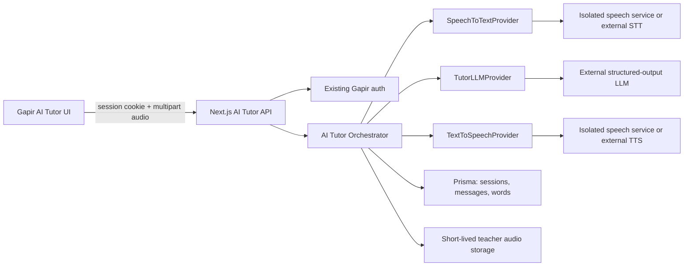
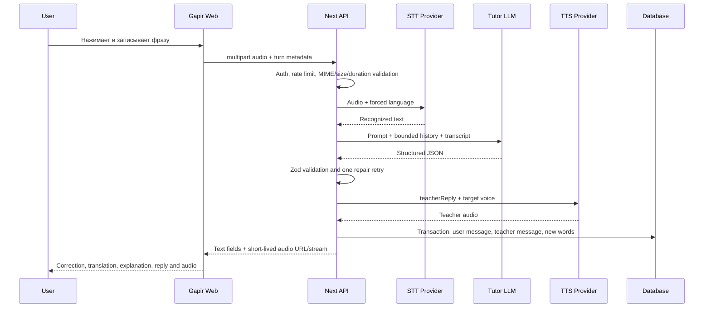
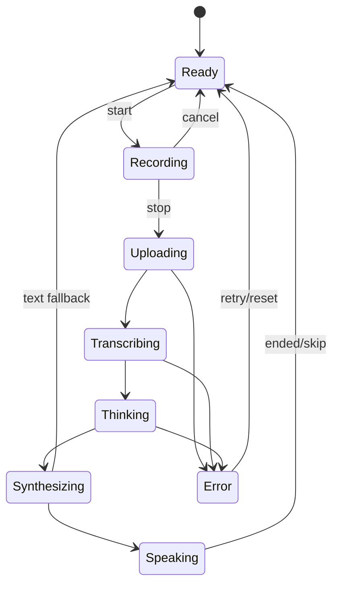

# Gapir AI Tutor - архитектура этапа 2

Дата: 4 августа 2026 года.

Статус: целевая архитектура согласования. Реализация, миграции, API, UI и модели пока не добавлены.

## 1. Архитектурное решение

Gapir остаётся Next.js-приложением и владельцем пользователей, сессий, диалогов, валидации и бизнес-правил. Ресурсоёмкое распознавание и синтез речи выносятся в отдельный speech service. Все поставщики скрыты за тремя интерфейсами:

- `SpeechToTextProvider`;
- `TextToSpeechProvider`;
- `TutorLLMProvider`.

Это позволяет начинать с внешних API, а затем по одному заменять их локальными моделями без переписывания UI и сценария урока.

## 2. Выбранный MVP-профиль

| Функция | Решение первой версии |
|---|---|
| UX | Одно записанное сообщение, не continuous call |
| Uzbek STT | Внешний API через provider adapter |
| Chinese STT | Fun-ASR-Nano batch/GGUF при успешном benchmark, иначе внешний adapter |
| Tutor LLM | Внешний API с обязательным structured JSON |
| Uzbek TTS | Внешний API |
| Chinese TTS | Внешний API на текущем ноутбуке; CosyVoice provider готовится как заменяемый adapter |
| Хранение аудио | Raw user audio удаляется после обработки; teacher audio короткоживущее |
| Real-time/wake word | Не входят |

## 3. Контекстная схема



Браузер не знает URL/ключи STT, TTS или LLM. Он работает только с `/api/ai-tutor/*`.

## 4. Границы модулей

### 4.1 Next.js / Gapir

Будущая структура, адаптированная к текущему проекту:

```text
app/
  ai-tutor/
    page.tsx
  api/
    ai-tutor/
      sessions/route.ts
      sessions/[sessionId]/messages/route.ts
      sessions/[sessionId]/finish/route.ts

src/
  features/
    ai-tutor/
      components/
      hooks/
      services/
      types/
      validation/
  server/
    ai/
      config/
      prompts/
        uzbek-native-learning-chinese.ts
        chinese-native-learning-uzbek.ts
      providers/
        speech-to-text-provider.ts
        text-to-speech-provider.ts
        tutor-llm-provider.ts
        adapters/
      services/
        ai-tutor-service.ts
        audio-validation-service.ts
        tutor-response-service.ts
      validation/
```

### 4.2 Изолированный speech service

В будущей реализации это отдельный deployable, не вложенный Python loop внутри Next:

```text
services/
  ai-speech/
    pyproject.toml
    src/gapir_speech/
      api/
      config/
      stt/
        faster_whisper_provider.py
        fun_asr_provider.py
      tts/
        cosyvoice_provider.py
      audio/
      security/
    tests/
```

Минимальные внутренние endpoints:

- `GET /health/live` - процесс жив;
- `GET /health/ready` - выбранные модели загружены;
- `POST /v1/stt` - аудио + язык -> текст и метаданные;
- `POST /v1/tts` - текст + язык + voice id -> поток/файл аудио.

Speech service не доступен публичному браузеру. Доступ только по private network или service token + TLS. CORS ему не нужен.

## 5. Provider contracts

Контракты ниже описывают форму, а не готовый код.

```ts
type TutorLanguage = "uz" | "zh";

interface SpeechToTextProvider {
  transcribe(input: {
    audio: ReadableStream<Uint8Array> | Uint8Array;
    mimeType: string;
    language: TutorLanguage;
    requestId: string;
  }): Promise<{
    text: string;
    language: TutorLanguage;
    confidence?: number;
    durationMs: number;
    provider: string;
  }>;
}

interface TextToSpeechProvider {
  synthesize(input: {
    text: string;
    language: TutorLanguage;
    voiceId: string;
    requestId: string;
  }): Promise<{
    audio: ReadableStream<Uint8Array> | Uint8Array;
    mimeType: "audio/mpeg" | "audio/wav" | "audio/ogg";
    durationMs?: number;
    provider: string;
  }>;
}

interface TutorLLMProvider {
  respond(input: TutorTurnInput): Promise<TutorTurnResult>;
}
```

Правило: provider не обращается к Prisma и не решает учебную бизнес-логику. Он только адаптирует внешний/local engine к стабильному контракту.

## 6. Поток одного сообщения



Если TTS падает после корректного LLM-ответа, текст всё равно возвращается пользователю с `audioStatus: "unavailable"`. Сообщение не теряется.

## 7. API-контракты Gapir

### 7.1 Создание сессии

`POST /api/ai-tutor/sessions`

```json
{
  "learningDirection": "UZ_NATIVE_LEARNING_ZH",
  "level": "BEGINNER",
  "topic": "RESTAURANT"
}
```

Сервер разрешает только два направления, три уровня и шесть тем MVP. `nativeLanguage` и `targetLanguage` вычисляются сервером, а не принимаются как независимые значения.

### 7.2 Отправка реплики

`POST /api/ai-tutor/sessions/{sessionId}/messages`, `multipart/form-data`:

- `audio`: один файл;
- `clientTurnId`: UUID для idempotency;
- `declaredMimeType`;
- `clientDurationMs` как подсказка, но не источник доверия.

Предлагаемые пределы Stage 3:

- до 60 секунд;
- до 15 MB;
- allowlist: WebM/Opus, Ogg/Opus, MP4/AAC и WAV;
- проверка magic bytes и реальной длительности после decode;
- mono 16 kHz PCM создаётся только во временном каталоге сервиса;
- случайное имя, без пользовательского пути;
- удаление в `finally` при успехе, timeout и ошибке.

### 7.3 Завершение

`POST /api/ai-tutor/sessions/{sessionId}/finish` вычисляет сводку из уже сохранённых turns. Он идемпотентен и не начисляет XP дважды.

## 8. Строгий ответ Tutor LLM

Базовая форма пользователя сохранена, но добавлены машинные поля состояния:

```json
{
  "recognizedText": "",
  "correctedText": "",
  "translation": "",
  "explanation": "",
  "teacherReply": "",
  "newWords": [
    {
      "word": "",
      "translation": ""
    }
  ],
  "score": 0
}
```

Серверная Zod-схема должна дополнительно ограничить:

- все строки по длине;
- `score` целым числом 0-100;
- `newWords` максимум 5 элементами;
- `teacherReply` языком изучения;
- `explanation` родным языком;
- отсутствие произвольных дополнительных полей.

Обработка плохого ответа:

1. structured-output/schema mode провайдера;
2. Zod parse;
3. один короткий repair retry с ошибками схемы;
4. если снова невалидно - стабильный `AI_RESPONSE_INVALID`, без падения процесса и без TTS;
5. raw LLM body не отправляется клиенту и не пишется в обычный лог.

## 9. Системные prompts

Два отдельных шаблона обязательны:

### UzbekNativeLearningChinese

- родной язык: узбекский, латиница;
- изучаемый язык: упрощённый китайский;
- пользовательская речь ожидается на китайском;
- correction и teacher reply - китайский;
- translation и explanation - узбекский;
- объяснение не длиннее 2-3 коротких предложений;
- следующий вопрос продолжает выбранную тему и соответствует уровню.

### ChineseNativeLearningUzbek

- родной язык: упрощённый китайский;
- изучаемый язык: узбекский, латиница;
- пользовательская речь ожидается на узбекском;
- correction и teacher reply - узбекский;
- translation и explanation - китайский;
- узбекские апострофы нормализуются, но смысловые буквы `o‘`/`g‘` не теряются;
- остальные ограничения аналогичны первому prompt.

Prompt получает server-owned `direction`, `level`, `topic`, ограниченную историю и transcript. Клиент не может подменить system instruction.

## 10. Клиентская state machine



Запись блокируется, пока предыдущий turn обрабатывается. `clientTurnId` предотвращает двойную отправку после retry. AbortController отменяет незавершённый upload при уходе со страницы.

## 11. Будущая модель данных

Названия согласованы с текущим Prisma style, а физические таблицы могут быть mapped к snake_case.

### AiTutorSession / `ai_tutor_sessions`

- `id`, `userId`;
- `learningDirection`;
- `nativeLanguage`, `targetLanguage`;
- `level`, `topic`, `status`;
- `startedAt`, `finishedAt`;
- counters: `turnCount`, `correctionCount`, `earnedXp`;
- index `(userId, startedAt)`.

### AiTutorMessage / `ai_tutor_messages`

- `id`, `sessionId`, `clientTurnId?`, `role`;
- `recognizedText?`, `correctedText?`, `translation?`, `explanation?`;
- `teacherReply?`, `score?`;
- `audioKey?`, `audioExpiresAt?`;
- `sttProvider?`, `ttsProvider?`, `llmProvider?`;
- `createdAt`;
- unique `(sessionId, clientTurnId)` для user turn.

### AiTutorWord / `ai_tutor_words`

- `id`, `sessionId`, `messageId?`;
- `sourceWord`, `translatedWord`, `language`;
- `createdAt`;
- уникальность по нормализованной паре внутри сессии.

Raw audio постоянно не сохраняется. `audioKey` относится только к сгенерированному teacher audio с TTL. Ссылки провайдера, API keys и внутренние filesystem paths не сохраняются.

## 12. Безопасность и приватность

- Авторизация каждой операции по текущей cookie-сессии.
- Проверка принадлежности `sessionId` текущему `userId`.
- CSRF-защита для state-changing routes: same-site cookie плюс Origin/Host check; для production желательно explicit token.
- Rate limit по user, IP и дорогой операции; отдельные лимиты create/turn/TTS replay.
- Timeout и circuit breaker для каждого внешнего provider.
- Ограничение concurrency на speech worker; модели не загружаются на каждый запрос.
- Service token ротируется; секреты не имеют `NEXT_PUBLIC_` prefix.
- Логи содержат request id, provider, latency и error code, но не raw audio, API keys или полный диалог по умолчанию.
- Consent/retention notice до первого включения микрофона.
- Фиксированный лицензированный голос; voice cloning выключен.
- Все внешние провайдеры проходят отдельную проверку data retention и training opt-out.

## 13. Ошибки, которые должен понимать UI

| Код | Сообщение UX |
|---|---|
| `MICROPHONE_UNAVAILABLE` | Микрофон недоступен |
| `AUDIO_TOO_LONG` | Запись слишком длинная |
| `AUDIO_TOO_LARGE` | Файл слишком большой |
| `AUDIO_FORMAT_UNSUPPORTED` | Формат аудио не поддерживается |
| `SPEECH_NOT_RECOGNIZED` | Речь не распознана; можно записать снова |
| `STT_UNAVAILABLE` | Сервис распознавания временно недоступен |
| `AI_RESPONSE_INVALID` | AI не смог подготовить ответ |
| `TTS_UNAVAILABLE` | Аудио недоступно, но текст ответа показан |
| `RATE_LIMITED` | Слишком много запросов; UI показывает retry time |
| `NETWORK_ERROR` | Нет соединения; локальная запись остаётся до retry/cancel |

UI всегда выходит из busy-state через `finally` и предоставляет retry/cancel.

## 14. Наблюдаемость и quality gates

Для каждого turn измеряются без записи содержания:

- upload time и размер;
- STT latency, real-time factor, пустой transcript rate;
- LLM latency, schema retry rate;
- TTS time-to-first-byte и total latency;
- total turn latency;
- provider error rate;
- user replay/retry/cancel rate.

До включения локальной модели обязательны:

- лицензия и pinned revision;
- checksum модели;
- 50+ фраз на язык, включая тишину, шум, числа, имена и code-switching;
- сравнение WER/CER и raw formatting;
- p50/p95 latency на целевом сервере;
- максимальный RAM/VRAM;
- ручная оценка TTS носителями языка;
- тест cleanup временных файлов.

## 15. Deployment boundaries

### Local development

- Next.js: `localhost:3000`;
- SQLite: существующая локальная база;
- speech service: loopback/private port;
- внешние adapters доступны только с сервера.

### Production

Наличие `.openai/hosting.json` не означает, что ML-модели можно запускать в edge runtime. При публикации web-части через Sites/Cloudflare:

- speech workers размещаются на отдельном CPU/GPU host;
- SQLite заменяется на поддерживаемую durable database до масштабирования;
- teacher audio помещается в private object storage с signed URL и TTL;
- Next/edge orchestrator использует HTTPS и короткие provider timeouts;
- тяжёлый запрос при необходимости переводится в job + polling, но для MVP предпочтителен синхронный лимитированный turn.

## 16. Порядок Stage 3 после подтверждения

1. Утвердить внешний MVP-набор провайдеров и правила хранения данных.
2. Подготовить собственный bilingual benchmark и критерии приёмки.
3. Добавить provider interfaces, fake adapters и unit tests без моделей.
4. Добавить Prisma migration и session/message API.
5. Реализовать запись одного сообщения и state machine.
6. Подключить external STT/LLM/TTS adapters.
7. Проверить end-to-end fallback без аудио.
8. После отдельного разрешения скачать и benchmark Fun-ASR GGUF.
9. После отдельного разрешения benchmark CosyVoice/Navoiy на целевом GPU.
10. Только затем решать, какие внешние providers заменять локальными.

До подтверждения этого документа ни один пункт Stage 3 не выполняется.

